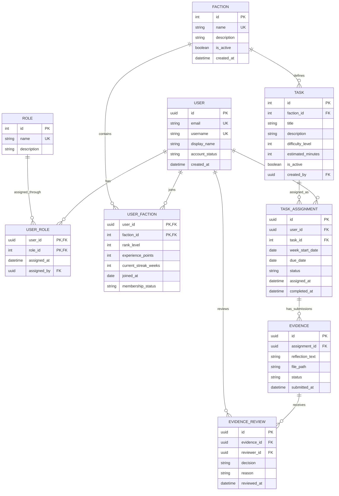

Opišite podatkovni model rešitve. Opis oz. vizualizacija bosta seveda odvisna od izbrane podatkovne baze.

Vključite:

- vsaj tri povezane entitete,
- glavna polja posamezne entitete,
- povezave med entitetami,
- osnutek podatkovnega modela.

Osnutek je lahko zapisan kot seznam, tabela, diagram ali Mermaid diagram.

---

### Izbran tip podatkovne baze: PostgreSQL

Razlogi za izbiro PostgreSQL:
- **jasno povezani podatki**, kot so uporabniki, ločine ("factions"), naloge ("tasks") in dokazila opravljenih nalog,
- **podpora pravilom aplikacije** (zagotovi se lahko primer, da isti uporabnik iste naloge ne dobi dvakrat za enak teden ali da uporabnik ne preveri istega dokazila večkrat)
- **sledljivost** (shranjevanje zgodovine oddaj dokazil, odločitev pri preverjanju ...)

***Izbrana podatkovna baza: Supabase***

### Moj podatkovni model ima ***9 entitet***:

Pomen kratic:

- PK - primary key
- FK - foreign key

### 1. User
- id (PK)
- email (unique)
- username (unique)
- display_name
- account_status
- created_at

### 2. Role
- id (PK)
- name (unique) ...Member, Moderator ali Administrator
- description

### 3. UserRole
- user_id (PK, FK)
- role_id (PK, FK)
- assigned_at
- assigned_by (FK, optional)

Opomba: user_id in role_id sta v kombinaciji primarni ključ. Tako ni možno dodeliti iste vloge istemu uporabniku večkrat.

### 4. Faction
- id (PK)
- name (unique)
- description
- is_active
- created_at

### 5. UserFaction
- user_id (PK, FK)
- faction_id (PK, FK)
- rank_level
- experience_points
- current_streak_weeks
- joined_at
- membership_status

Opomba: user_id in faction_id sta v kombinaciji zagotovilo, da ima uporabnik samo en zapis "članstva" v posamezni ločini

### 6. Task
- id (PK)
- faction_id (FK)
- title
- description
- difficulty_level
- estimated_minutes
- is_active
- created_by (FK, optional)

### 7. TaskAssignment
- id (PK)
- user_id (FK)
- task_id (FK)
- week_start_date
- due_date
- status
- assigned_at
- completed_at

omejitev: unikatna kombinacija user_id, task_id in week_start_date, da ista naloga ni dodeljena uporabniku dvakrat za isti teden

### 8. Evidence
- id (PK)
- assignment_id (FK)
- reflection_text
- file_path
- status
- submitted_at

Opomba: file_path je zato, ker bom v bazi hranila le URL do fotografije ali datoteke, hranile se bodo v datotečni shrambi, da ne preobremenijo baze

### 9. EvidenceReview
- id (PK)
- evidence_id (FK)
- reviewer_id (FK)
- decision ... approved/rejected
- reason (optional)
- reviewed_at

Omejitev: 
- unikatna kombinacija evidence_id in reviewer_id, da isti član istega dokazila ne preverja večkrat

- uporabnik ne sme preverjati lastnega dokazila

### Mermaid Diagram

Povezave med entitetami so vidne v spodnjem diagramu:

Legenda:

- PK = primarni ključ, 
- FK = tuji ključ,
- UK = unikatna vrednost 

Dodatni unikatni omejitvi: 
- TASK_ASSIGNMENT (user_id, task_id, week_start_date)
- EVIDENCE_REVIEW (evidence_id, reviewer_id)

