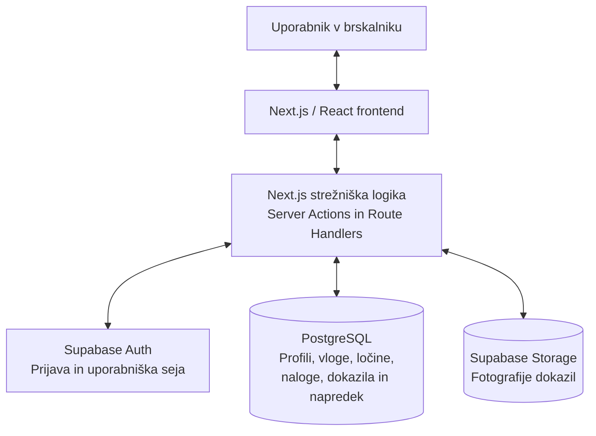

Opišite tehnično zasnovo rešitve.

**Arhitektura**:

- glavne dele sistema,
- komunikacijo med deli sistema,
- podatkovno bazo,
- način avtentikacije oziroma upravljanja uporabnikov,
- način lokalnega zagona.

Dodajte tudi preprost diagram.

**Tehnološki sklad**

Navedite tehnologije in orodja za:

- frontend,
- backend,
- podatkovno bazo,
- avtentikacijo,
- lokalni razvoj,
- morebitne druge dele aplikacije.

**Arhitekturne odločitve**

Vse pomembne arhitekturne odločitve ali izbire na kratko utemeljite.

---

# 1. Arhitektura

Izbrana arhitektura: **večplastna monolitna arhitektura**, kar pomeni, da je aplikacija organizirana v dele, a se frontend in backend razvijata znotraj enega projekta. To mi omogoča Next.js.

## Glavni deli sistema:

### 1. __Uporabniški vmesnik__ (frontend)
- Next.js, React, TypeScript

### 2. __Aplikacijska logika__ (backend)
- Next.js Server Actions, Route Handlers

### 3. __Podatkovne storitve__
- Supabase (PostgreSQL, Supabase Auth, Supabase Storage)

## Komunikacija med deli sistema:

1. Uporabnik odpre spletno aplikacijo in se prijavi.
2. Preko Supabase Auth se preveri njegova identiteta in vzpostavi se uporabniška seja.
3. Frontend pošlje zahtevo strežniškemu delu, npr. za prikaz tedenskih nalog.
4. Backend preveri uporabniško sejo, veljavnost podatkov in pravice uporabnika.
5. Backend prek Supabase dostopa do PostgeSQL ter po potrebi do shrambe datotek
6. Rezultat je vrnjen v uporabniški vmesnik, ki prikaže posodobljeno stanje

Primer: ko član odda dokazilo, ga sistem shrani in označi kot čakajoče na preverjanje. Ko drug član dokazilo potrdi, se posodobi stanje dokazila in dodeljene naloge, napredek pa se ustrezno preračuna.

Preverjanje pravic se ne izvaja samo v uporabniškem vmesniku. Tudi če član ročno spremeni zahtevo, mora backend preprečiti nedovoljen poseg. Zato je Supabase odličen kot dodatna plat zaščite, saj podpira dostop na ravni posameznih vrstic (RLS: row-level security) v PostgreSQL.

## Podatkovna baza:

Izbrana podatkovna baza: __PostgreSQL__, ki mi jo bo zagotovil __Supabase__.

Struktura posameznih entitet in atributov je že opisana v 03-podatkovni-model.md.

## Avtentikacija:

Za avtentikacijo bom uporabljala __Supabase Auth__. To pomeni, da v svoji lastni tabeli ne bom hranila gesel (niti v šifrirani obliki).

- Primarni ključ profila bo povezan z identifikatorjem uporabnika iz Supabase Auth.

Funkcionalnosti:
- registracija z elektronskim naslovom in geslom
- prijava in odjava
- preverjanje uporabniške seje
- ponastavitev pozabljenega gesla
- povezava avtentikacijskega računa z uporabniškim profilom

Uporabniške vloge se upravljajo v ločeni podatkovni tabeli.

Fotografije dokazil bodo shranjene v zasebnem prostoru datotek (private storage bucket), v tabeli "Evidence" pa bom hranila pot do datoteke in druge metapodatke. Dostop bo omogočen samo ustrezno pooblaščenim uporabnikom.

## Lokalni zagon aplikacije:

- Node.js LTS in npm (zagon spletne aplikacije in nameščanje paketov)
- Docker Desktop (kontejnerji)
- Supabase CLI (lokalni zagon PostgreSQL, Auth in Storage)
- Next.js development server (ogled in testiranje v brskalniku)

postopek zagona:
1. namestitev dependencies
```
npm install
```
2. zagon lokalnega Supabase
```
npx supabase start
```
3. zagon strežnika
```
npm run dev
```

---

# Tehnološki sklad

- __Frontend__: Next.js, React, TypeScript
- __Oblikovanje__: Tailwind CSS
- __Backend__: Next.js Server Actions in Route Handlers
- __Podatkovna baza__: PostgreSQL preko Supabase
- __Dostop do podatkov__: Supabase JavaScript Client
- __Avtentikacija__: Supabase Auth
- __Datotečna shramba__: Supabase Storage
- __Lokalni razvoj__: Node.js LTS, npm, Docker, Supabase CLI
- __Razvojna orodja__: Visual Studio Code, Git

Za trenutni obseg projekta bi bil ločen backend nepotrebna dodatna plast. Next.js že omogoča strežniško obdelavo zahtev in implementacijo poslovne logike. Če bi se aplikacija v prihodnosti razširila v več ločenih odjemalcev ali zahtevala veliko kompleksnejših procesov, lahko potencialno dodam ločen backend.

# Arhitekturne odločitve

Zakaj Next.js namesto ločen frontend in backend?
- manj komponent, ki jih je potrebno nastaviti in vzdrževati

Zakaj relacijska podatkovna baza?
- relacijski model je bolj primeren za povezave med uporabniki, ločinami, nalogami, preverjanji dokazil opravljenih nalog

Zakaj Supabase?
- ker poleg navadnega PostgreSQL ponuja avtentikacijo, shrambo datotek in lokalno razvojno okolje, torej je manj infrastrukture za razviti od začetka

Zakaj so slike v shrambi datotek?
- baza ostane lažja

Zakaj lokalni zagon preko Dockerja?
- omogočen ponovljiv zagon istega okolja na različnih računalnikih

Zakaj modularna monolitna arhitektura?
- razdelim kodo na module, a ohranim preprosti lokalni razvoj

## Diagram izbrane arhitekture:

